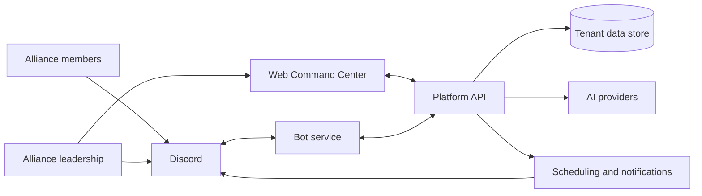

# Architecture Overview (High Level)

Conceptual view only — no implementation, hosting, or security details.

- **Per-alliance tenancy:** each customer alliance has its own configuration and data boundary.
- **Discord as delivery channel:** the platform is the system of record; Discord carries notifications and commands.
- **Guarded AI usage:** AI calls pass through cost and access controls.
